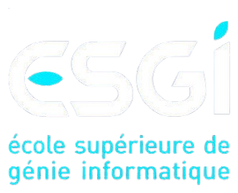
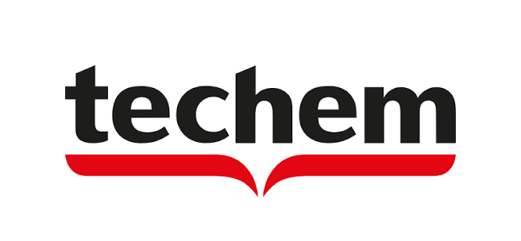

<h3 align="center">
First-year student at <b>ESGI Paris</b> and apprentice at <b>Techem</b>, 
where I do hands-on IT support and workstation administration.
</h3>

<h2 align="center">What I do</h2>

  
  &nbsp;&nbsp;&nbsp;&nbsp;
  

🎓 <b>School:</b> ESGI Paris, first year, work-study 
💼 <b>Work:</b> Techem, Systems & Networks apprentice

<h2 align="center">Tools</h2>

  

<h2 align="center">Currently</h2>

    
    
  

  

🎯 <i>Challenging myself to take the <b>CCNA</b> in 2027.</i>

<h2 align="center">Contact</h2>

  
  

